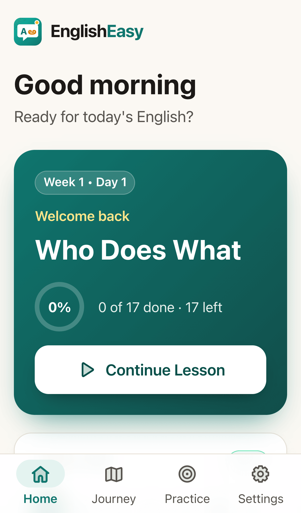
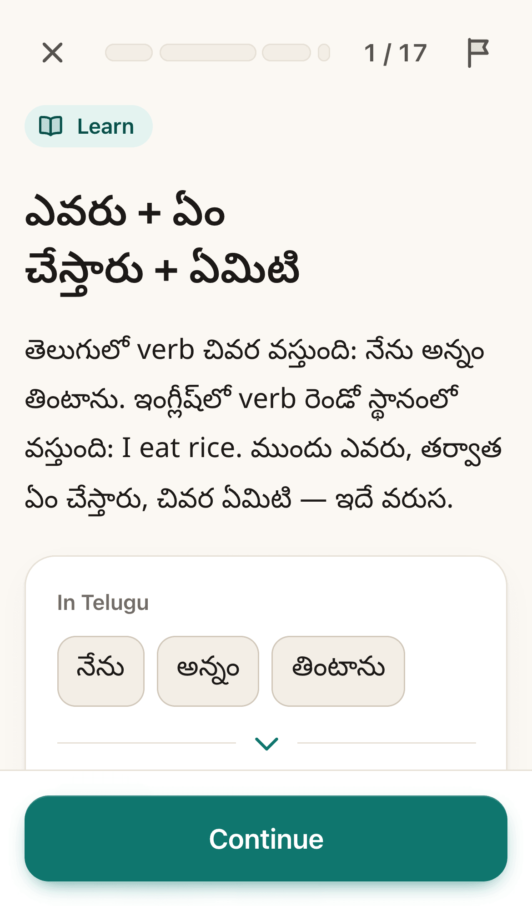
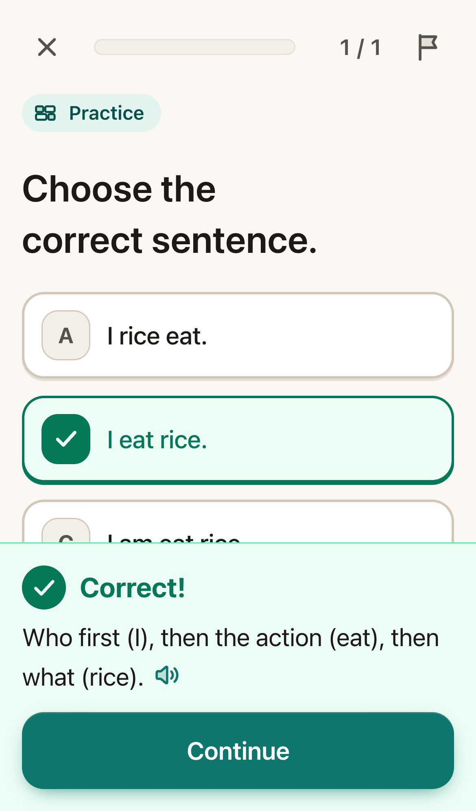
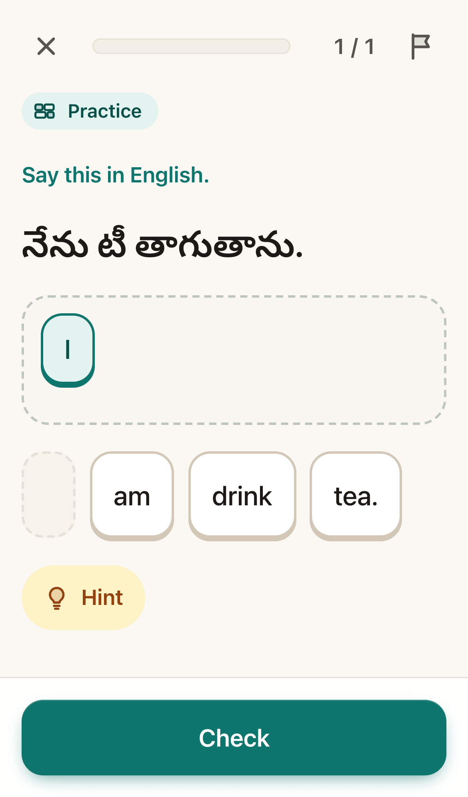
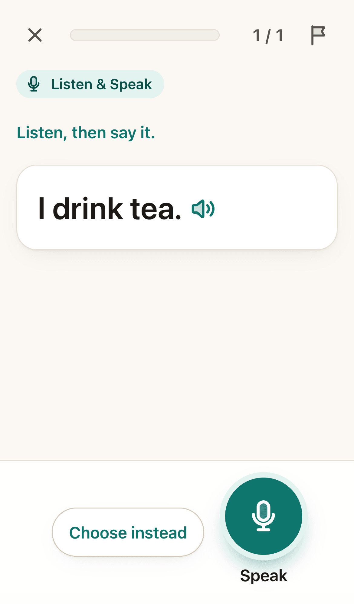
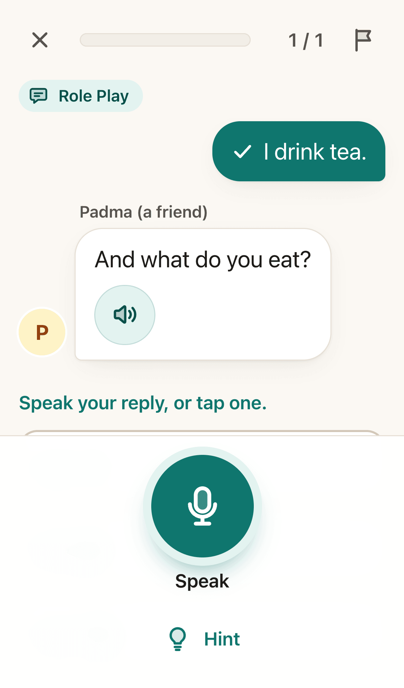
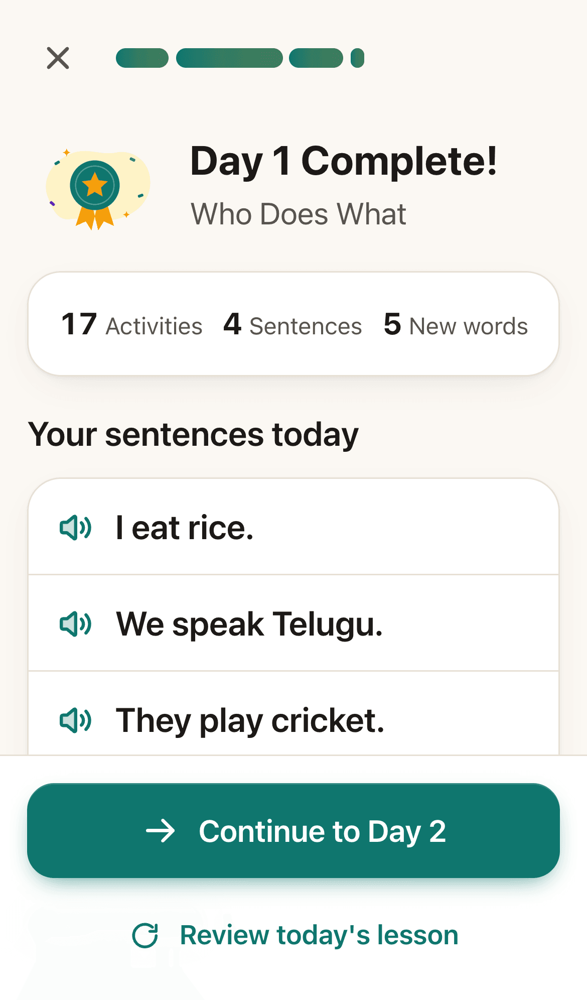
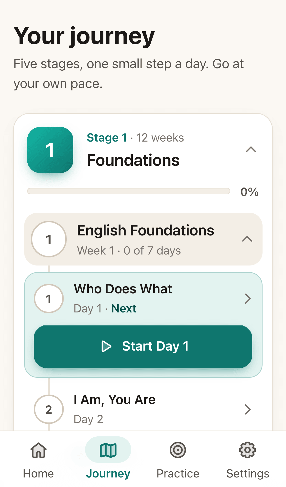

# EnglishEasy

A **free and open-source** app for learning to speak English, made for Telugu-speaking adults and elders. Short daily lessons with Telugu explanations: hear a sentence, build it from word tiles, say it aloud, and practice it in a short role play. No typing, no ads, no subscription, and no account needed.

It's an installable web app (Next.js on Vercel) that works offline. It's guest first, with optional Google sign-in to sync progress, and there's no AI at runtime: lessons and recordings are made ahead of time. The code is open source under the [MIT license](LICENSE), and it runs on free tiers.

**Try it:** [learn-english-in-telugu.vercel.app](https://learn-english-in-telugu.vercel.app)

Plan and vision are in `docs/` (start with `docs/BUILD_PLAN.md`).

## Features

- Eighty weeks released (560 days): Stage 1 (Weeks 1–12), Stage 2 (Weeks 13–40) and Stage 3 (Weeks 41–80). Each lesson: explain, practice, speak, role play; each week ends with a Conversation Day and a review, which from Stage 3 closes with a story heard first.
- Learn in Telugu or English. Two recorded voices on every phone, a woman's and a man's (made ahead of time with `npm run audio`), read the sentences, questions and conversations; longer sentences can also be played slowly. The phone's own voice is only a backup.
- Hear first: Conversation Days are heard before they are read, "build what you hear" tiles come from the voice alone, and a Sound of the week trains the sounds Telugu speakers find hard (v/w, ship/sheep, thirteen/thirty, th…) with a "which word did you hear?" question in every lesson. Long sentences are repeated in steps.
- Role plays: speak first (the replies are one tap away), hints say what to do, and the other person answers back to what you say.
- Daily review: the key sentences of finished lessons come back after 1, 3, 7, 21 and 60 days, five a day.
- No typing: answers are buttons, word tiles or voice; speaking never blocks progress ("Choose instead").
- Home, Journey, Practice hub (daily review, mistakes, role plays, sentences, speaking, tracks).
- Guest first; optional Google sign-in syncs progress.
- Installable, works offline for lessons in use; optional daily reminders.
- Report a problem or send feedback from the app; Day / Night / Device themes; text sizes A-, A, A+, A++.
- No AI or paid speech API at runtime.
- Content standards (`docs/CURRICULUM.md` §1, `docs/CONTENT_PLAYBOOK.md`) with automatic checks: `node --import tsx scripts/check-week.mts <week>`.

## Screenshots

<table>
  <tr>
    <td align="center" width="25%"><br><sub>Home: today's lesson and this week</sub></td>
    <td align="center" width="25%"><br><sub>Learn: the idea explained in Telugu</sub></td>
    <td align="center" width="25%"><br><sub>Practice: tap the right answer</sub></td>
    <td align="center" width="25%"><br><sub>Build a sentence from word tiles</sub></td>
  </tr>
  <tr>
    <td align="center" width="25%"><br><sub>Speak: say it aloud</sub></td>
    <td align="center" width="25%"><br><sub>Role play: speak first, replies one tap away</sub></td>
    <td align="center" width="25%"><br><sub>Lesson complete</sub></td>
    <td align="center" width="25%"><br><sub>Journey: five stages, week by week</sub></td>
  </tr>
</table>

These are real phone screens from `e2e/capture.spec.ts`. To refresh them, run `npm run test:e2e`, copy `test-results/screenshots/capture-*.png` into `docs/screenshots/` (without the `capture-` prefix), then run `npm run images`. It rebuilds the landing page's pictures and the link and social previews from them.

## Commands

```bash
npm run dev          # http://localhost:3000
npm run lint
npm run typecheck
npm test             # Vitest; one file: npx vitest run <file>
npm run build
npm run db:ping      # check the MongoDB connection (.env.local)
npm run db:setup     # create the indexes in MONGODB_DB
npm run reports      # latest problem reports and client errors (.env.local)
npm run test:db      # repository tests against MongoDB (needs MONGODB_URI; uses throwaway englisheasy_test_* databases)
npm run vapid        # print a new VAPID key pair for daily reminders
npm run images       # favicon, icons and link preview from src/app/icon.svg
npm run test:e2e     # Playwright on port 3100 (projects: phone, desktop)
```

## Environment variables

| Name | Where | Use |
|------|-------|-----|
| `GTM_ID` | Vercel Production only (read at build) | Google Tag Manager container, e.g. `GTM-ABC123`; loaded on the landing page only. Unset: not loaded. |

| `MONGODB_URI`, `MONGODB_DB` | `.env.local`, Vercel | Atlas connection string and database: `englisheasy_dev` locally, `englisheasy_preview` for previews, `englisheasy` in Production. |
| `BETTER_AUTH_SECRET` | `.env.local`, Vercel | Signs sessions. A different value in every environment (`openssl rand -base64 32`). |
| `BETTER_AUTH_URL` | `.env.local` (`http://localhost:3000`), Vercel Production only | The app's own address; previews use Vercel's own hosts. |
| `GOOGLE_CLIENT_ID`, `GOOGLE_CLIENT_SECRET` | `.env.local`, Vercel | The Google OAuth client. |
| `OAUTH_PROXY_SECRET` | Vercel Production and Preview (same value), only if previews are used | Lets previews sign in through production. |
| `NEXT_PUBLIC_VAPID_PUBLIC_KEY`, `VAPID_PRIVATE_KEY`, `VAPID_SUBJECT` | `.env.local`, Vercel | Daily reminders (web push). Run `npm run vapid` for the keys; the subject is `mailto:` your email. |
| `REMINDER_SECRET` | Vercel and the GitHub repository secrets (same value); GitHub variable `REMINDER_URL` = the production address | The hourly workflow `.github/workflows/reminders.yml` calls `POST /api/reminders/send` with it. |

Each one added in a later step goes in `.env.example` and here.

## Run your own copy

1. **MongoDB Atlas.** Create a free cluster, a database user with read and write access, and allow network access from anywhere (Vercel has no fixed address). Copy the connection string into `MONGODB_URI`; set `MONGODB_DB` to `englisheasy_dev` locally and `englisheasy` in Vercel Production (`englisheasy_preview` for Preview).
2. **Google OAuth client.** In Google Cloud Console, set up the OAuth consent screen (app name EnglishEasy, the privacy page `/privacy` as the privacy policy link), then create a Web application client. Authorised redirect URIs: `http://localhost:3000/api/auth/callback/google` and `https://<your production domain>/api/auth/callback/google`. Copy the client id and secret into `GOOGLE_CLIENT_ID` and `GOOGLE_CLIENT_SECRET`.
3. **Local.** `cp .env.example .env.local`, fill it in, then `npm run db:ping` (checks the connection) and `npm run db:setup` (creates the indexes; run it once for each database, `englisheasy` before the first production deploy).
4. **Vercel.** Add the variables in the table above for Production (and Preview if used); `BETTER_AUTH_URL` in Production only; a different `BETTER_AUTH_SECRET` per environment. Vercel's system variables (`VERCEL_ENV`, `VERCEL_URL`, `VERCEL_BRANCH_URL`, `VERCEL_PROJECT_PRODUCTION_URL`) must be exposed. Deploy `master`.
5. **Daily reminders.** `npm run vapid`, put the three lines in `.env.local` and Vercel; add `REMINDER_SECRET` (any long random text) in Vercel and as a GitHub repository secret, and `REMINDER_URL` as a GitHub repository variable; run `npm run db:setup`. After pushing, run the "reminders" workflow once by hand from the GitHub Actions tab.

`npm run db:ping` and `npm run db:setup` read `.env.local`.

## Adding content

Content is data in `src/content/` and is validated by `content.test.ts`. To add or fix lessons, follow `docs/BUILD_PLAN.md` Part E: E2 writes a week, E3 writes or rewrites one day, E4 fixes reported problems (`npm run reports` lists them), E5 writes a track week. Ids are permanent once released. Run `npm run content` and `npm test` before committing, then `npm run audio` to record any new or changed sentences, and commit `public/audio/` too.

## Launch check

Run Lighthouse (phone) on the production URL; targets are Performance 90 or more, Accessibility 95 or more, Best Practices 95 or more, SEO 100.

**Search engines.** Only production is open to them (`robots.txt` keeps previews and `/learn` out). In [Google Search Console](https://search.google.com/search-console), add a **URL prefix** property for the production address and verify it with the **HTML tag** method (the code goes in `GOOGLE_SITE_VERIFICATION` in `src/components/landing/content.ts`; a copy of this repo needs its own code). Then submit `https://<your production domain>/sitemap.xml`. It lists the landing page, the privacy page and every released lesson's overview page, and grows by itself as weeks are released.

## Free and open source

EnglishEasy is free to use: there are no ads, no subscription and nothing to buy. Its code is open source under the [MIT license](LICENSE), so anyone can read it, suggest a fix or a lesson, or run their own copy on the free tiers of Vercel and MongoDB Atlas (see [Run your own copy](#run-your-own-copy)).

If it helps you or your family, you can [buy me a coffee](https://buymeacoffee.com/harikiranvusirikala).
